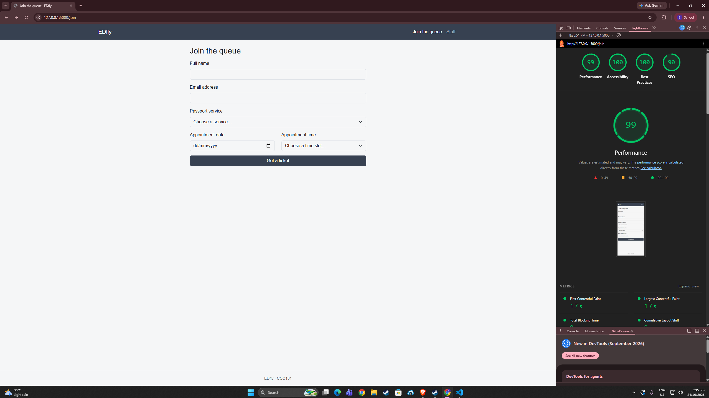
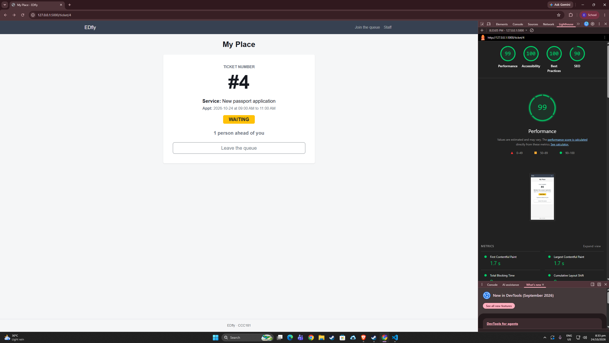
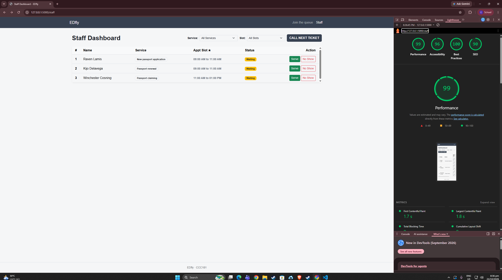

# Week 3 accessibility check

## 9a. Lighthouse (Accessibility, Mobile)

| Screen | Score | Screenshot |
| --- | --- | --- |
| Join the queue | 99 |  |
| My place | 99 |  |
| Staff dashboard | 99 |  |

Issue and Fix : None

## 9b. Keyboard only

**Join the queue from the home page:** I could see where the focus was at every step because each control gets a visible highlight. I reached every field and the "Get a ticket" button and submitted the form to get a ticket.
**Staff dashboard and skip link:** Yes, i can see clearly where it went because it will be highlighted, on the staff dashboard I can access filter service and call a ticket and serve with no problem at all, the skip link is a big help in doing those jobs. so far as a techy person I found no problem using it at all.

## 9c. Manual checklist
| Check | Join | My place | Staff |
| --- | --- | --- | --- |
| Every input has a visible label |✅|✅|✅|
| Error messages say what to do, in text |✅|✅|✅|
| Status is shown in words, not only color | ✅| ✅| ✅|
| Text and buttons are readable at 375 px with no sideways page scroll |✅ |✅ |✅ the table scroll inside its box, not the page|
| Buttons are at least about 44 × 44 px on a phone |✅ been fix the get a ticket is now big enough|✅|✅ serve and no show is enlarge|
| Page has one `<h1>` and headings in order |✅|✅|✅|
| `<html lang="en">` (or your language) is set |✅|✅|✅|

