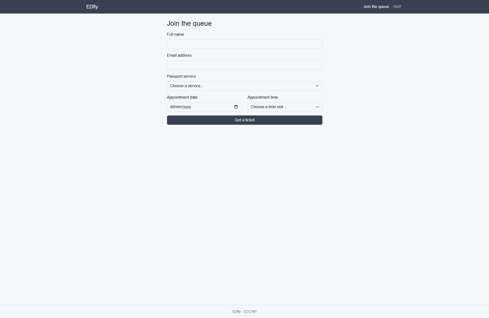
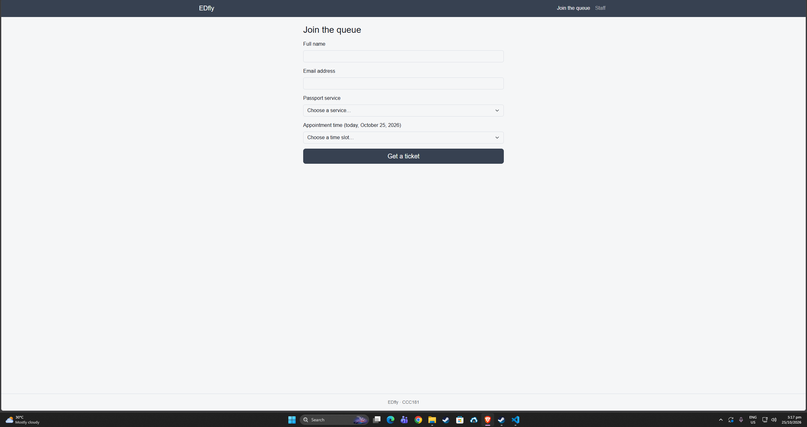

# Week 3 usability test

**Participant:** My sister, an adult who has been through the passport process.
**Date:** October 25, 2026
**Setup:** my desktop for both a laptop-width and a phone-width test (DevTools device mode at 375 px).

## Tasks

- Did they finish it? Yes 
- About how long it took? 1-2 mins 
- Where they hesitated, what they said, and anything that surprised you? about how easy it is to used and convenient for people who want to save time and the downside is for the people who are not techy enough for example those people who are a little bit older and not familiar with the digital profiling or forms.
- Which of your persona's *"Because …, my interface must …"* rules held up, and which did not? the My place page shows the exact count of people ahead, so she knew how many people were in front of her. after the accessibility fix, all main buttons are at least about 44 px tall, so they are easy to tap. The rule that did not hold  was for example Kijo rule 3 was “show the exact count of people ahead” to save time and know exactly where to go, but the Appointment date field made my tester stop and ask why a date was needed when only today is accepted. I fixed this in 10b.

## Improvement (10b)

**Problem:** the form asked for an Appointment date, but the server only accepts today's date. My tester was confused about why she had to choose a date with only one valid answer (error prevention).
**Fix:** I removed the date field. The form now shows "today" as text next to the Appointment time label, and the server sets the date automatically. The time dropdown is still validated on the server.

**Before:** 
**After:** 

## Not fixed this week
Older or less technical users may still struggle with a digital form. I'll note this in the Reflection of my report.