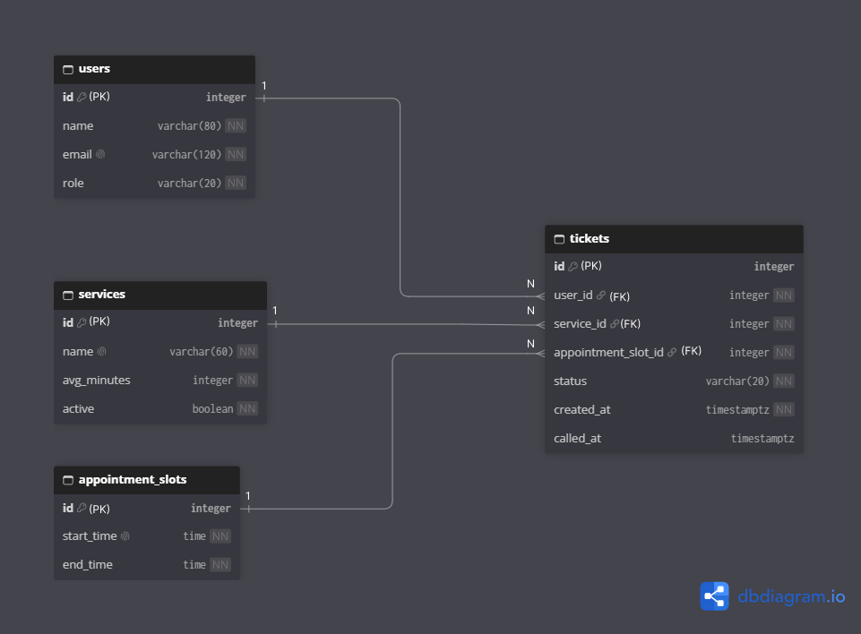
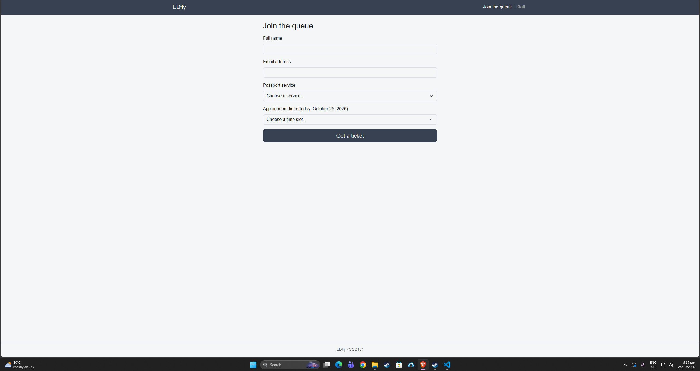
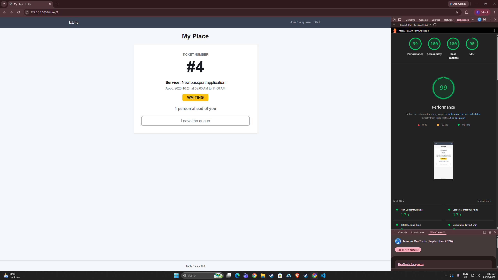
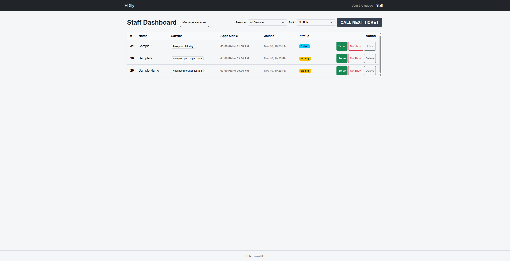
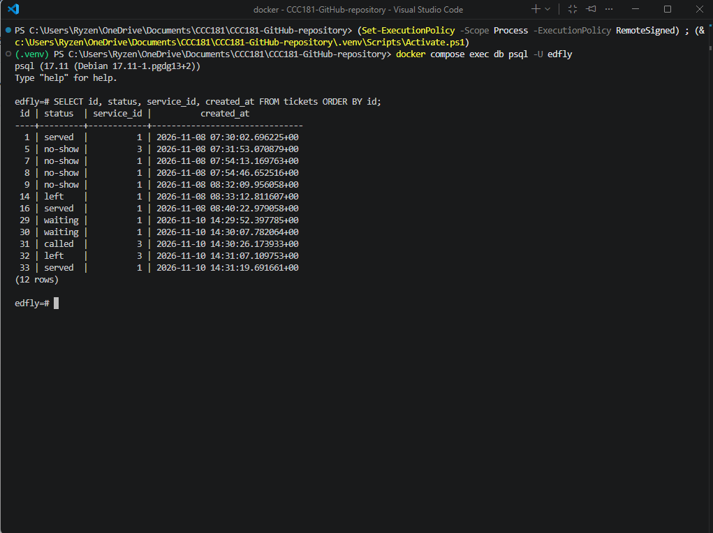
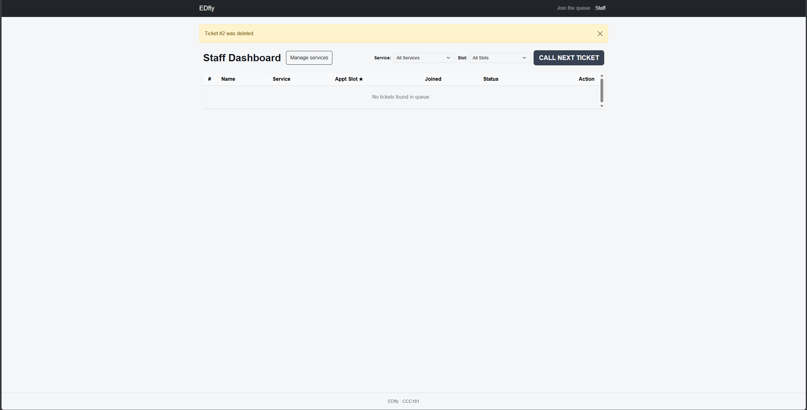
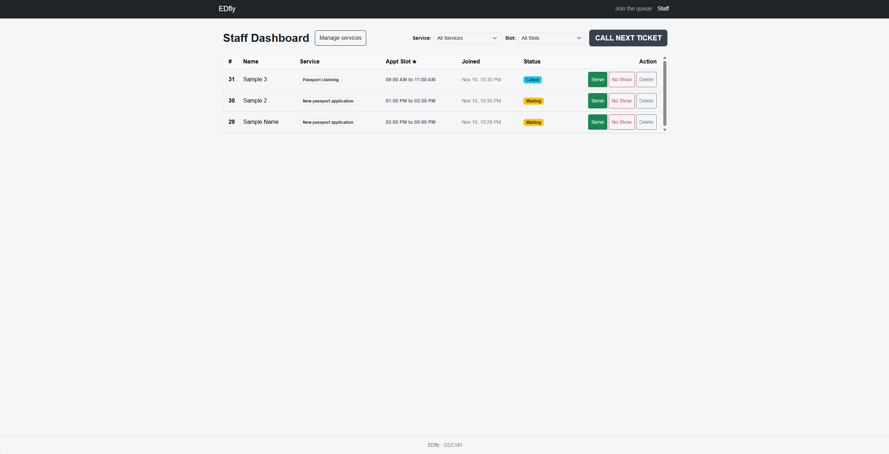
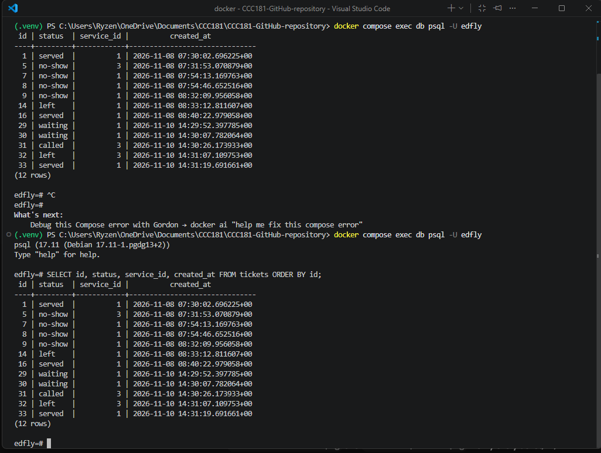

# Report: Edfly Database 

## 1 Title details
- **App name:** EDfly
- **Setting:** Passport office, weekday appointments in four 2-hour slots (9-11, 11-1, 1-3, 3-5)
- **Full name:** Eddie Castre Jr.
- **Student ID:** 2024-0459
- **Section:** CCC181 (CS3B)
- **Date:** November 10, 2026
- **Pull request link:** https://github.com/eddie2252/CCC181-GitHub-repository/pull/4

## 2 Requirements
- **Functional requirements count:** 14 (FR-01 to FR-14), including 3 setting-specific (★) requirements (FR-07 ★, FR-10 ★, FR-11 ★).
- **Non-functional requirements count:** 6 (NFR-01 to NFR-06).
- **MVP list:** FR-01, FR-02, FR-03, FR-04, FR-05, FR-06, FR-08, NFR-01, NFR-02, NFR-04, NFR-05.
- **Feedback & changes:** Tested with a passport applicant (sister). She noted that position in line didn't seem to change visibly and that status changes weren't immediate enough. Added FR-14 (clear badge color and message alert on My place when called without needing a reload).
- **Requirements link:** [docs/requirements.md](week4/requirements.md)

## 3 ERD


### Relationship sentences
- One user has many tickets (1 : N). Each ticket belongs to exactly one user.
- One service has many tickets (1 : N). Each ticket belongs to exactly one service.
- One appointment slot has many tickets (1 : N). Each ticket belongs to optional/assigned slot.
- Deleting a service or user uses `ON DELETE RESTRICT` to preserve historical ticket records for reports.

**Schema link:** [docs/week4/schema.md](schema.md)

## 4 Schema

```text
                                   Table "public.users"
 Column |          Type          | Collation | Nullable |              Default              
--------+------------------------+-----------+----------+-----------------------------------
 id     | integer                |           | not null | nextval('users_id_seq'::regclass)
 name   | character varying(80)  |           | not null | 
 email  | character varying(120) |           | not null | 
 role   | character varying(20)  |           | not null | 'visitor'::character varying
Indexes:
    "users_pkey" PRIMARY KEY, btree (id)
    "users_email_key" UNIQUE CONSTRAINT, btree (email)
Check constraints:
    "ck_users_role" CHECK (role::text = ANY (ARRAY['visitor'::text, 'staff'::text]))
Referenced by:
    TABLE "tickets" CONSTRAINT "tickets_user_id_fkey" FOREIGN KEY (user_id) REFERENCES users(id) ON DELETE RESTRICT
```

```text
                                   Table "public.services"
   Column    |          Type          | Collation | Nullable |               Default               
-------------+------------------------+-----------+----------+-------------------------------------
 id          | integer                |           | not null | nextval('services_id_seq'::regclass)
 name        | character varying(60)  |           | not null | 
 avg_minutes | integer                |           | not null | 10
 active      | boolean                |           | not null | true
Indexes:
    "services_pkey" PRIMARY KEY, btree (id)
    "services_name_key" UNIQUE CONSTRAINT, btree (name)
Check constraints:
    "ck_services_avg_minutes" CHECK (avg_minutes > 0)
Referenced by:
    TABLE "tickets" CONSTRAINT "tickets_service_id_fkey" FOREIGN KEY (service_id) REFERENCES services(id) ON DELETE RESTRICT
```

```text
                                   Table "public.appointment_slots"
   Column   |         Type          | Collation | Nullable |                   Default                    
------------+-----------------------+-----------+----------+----------------------------------------------
 id         | integer               |           | not null | nextval('appointment_slots_id_seq'::regclass)
 label      | character varying(40) |           | not null | 
 start_time | time without time zone|           | not null | 
 end_time   | time without time zone|           | not null | 
Indexes:
    "appointment_slots_pkey" PRIMARY KEY, btree (id)
Referenced by:
    TABLE "tickets" CONSTRAINT "tickets_appointment_slot_id_fkey" FOREIGN KEY (appointment_slot_id) REFERENCES appointment_slots(id) ON DELETE RESTRICT
```

```text
                                   Table "public.tickets"
        Column        |           Type           | Collation | Nullable |               Default               
----------------------+--------------------------+-----------+----------+-------------------------------------
 id                   | integer                  |           | not null | nextval('tickets_id_seq'::regclass)
 status               | character varying(20)    |           | not null | 'waiting'::character varying
 created_at           | timestamp with time zone |           | not null | now()
 called_at            | timestamp with time zone |           |          | 
 user_id              | integer                  |           | not null | 
 service_id           | integer                  |           | not null | 
 appointment_slot_id  | integer                  |           |          | 
Indexes:
    "tickets_pkey" PRIMARY KEY, btree (id)
    "uq_tickets_one_open_per_service" UNIQUE (user_id, service_id) WHERE status::text = ANY (ARRAY['waiting'::text, 'called'::text])
Check constraints:
    "ck_tickets_status" CHECK (status::text = ANY (ARRAY['waiting'::text, 'called'::text, 'served'::text, 'no-show'::text, 'left'::text]))
Foreign-key constraints:
    "tickets_appointment_slot_id_fkey" FOREIGN KEY (appointment_slot_id) REFERENCES appointment_slots(id) ON DELETE RESTRICT
    "tickets_service_id_fkey" FOREIGN KEY (service_id) REFERENCES services(id) ON DELETE RESTRICT
    "tickets_user_id_fkey" FOREIGN KEY (user_id) REFERENCES users(id) ON DELETE RESTRICT
```

## 5 Design decisions
1. **Slot-aware queue ordering over arrival timestamp** I sorted tickets primarily by `appointment_slot_id` (slot start time) and secondarily by `created_at` because an applicant booked for a 9:00 AM slot should be served before someone booked for a 3:00 PM slot, even if the 3:00 PM applicant pressed "Join" earlier in the morning. This directly supports FR-01, FR-07 ★, and Elena (staff persona) in managing crowd flow by time slot.
2. **Computed position ahead instead of a stored column** I computed the number of people ahead dynamically using `people_ahead(t)` rather than storing a position column because a stored position would require rewriting position numbers across dozens of database rows every time a ticket is called or leaves. This ties to FR-02 and NFR-02 to preserve data integrity and prevent race conditions.
3. **Soft delete on leaving queue:** Leaving the queue updates the ticket status to `left` instead of deleting the row, keeping data intact for administrative reports.

## 6 Self-review
From `schema-review.md`:
- **Works well:** Storing `created_at` and `status` on `tickets` instead of position; position is computed on demand so it cannot go stale. Added partial unique index `uq_tickets_one_open_per_service` to prevent double-booking active tickets for the same service.
- **Works well:** Foreign keys use `ON DELETE RESTRICT` so existing tickets remain available for the left-before-served report (FR-12). Kept `services.avg_minutes` with `CHECK (avg_minutes > 0)` for estimated wait functionality.
- **Works well:** Appointment slot times use `time` columns with `CHECK (end_time > start_time)`. Kept `end_time` stored so non-2-hour slots can be supported if needed.

## 7 Migrations
|Migration| What it does|
| --- | --- |
| `migrations/versions/f4de41978282_initial_tables.py`| Initial migration creating `users`, `services`, `appointment_slots`, and `tickets` tables along with foreign keys, check constraints, and partial unique index.|
| `migrations/versions/a07ec31b78e0_add_services_active.py`| Second migration adding the `active` boolean column with `server_default=true()` to `services`.|


## 8 CRUD
|Operation|Route|Requirement|Screenshot|
| --- | --- | --- | --- |
| **Create:** | `POST /join` | (FR-01) |  |
| **Read:** | `GET /queue/<id>` | (FR-02) |   |
| **Update:** | `POST /staff/tickets/<id>/<action>` | (FR-03, FR-04, FR-05, FR-06) |   |
| **Soft delete:** | `POST /queue/<id>/leave` | (FR-03) |   |
| **Hard delete:** | `POST /staff/tickets/<id>/delete` | (FR-09) |   |


## 9 Validation

Summary of `validation.md`: 
- Validation is enforced at the browser layer (`required`, `maxlength="80"`)
- Flask server layer (returns HTTP 400 for bad payloads) 
- PostgreSQL database constraints (CHECK, UNIQUE, FK).

The most useful PostgreSQL error was `ERROR: duplicate key value violates unique constraint "uq_tickets_one_open_per_service"`, which stops duplicate active tickets at the database level.


## 10 Persistence
- **Before restart screenshots:**
  - Staff dashboard: 
  - SQL query: 
- **After restart screenshots:**
  - Staff dashboard: 
  - SQL query: 
- **Rebuild from scratch result:** `docker compose down -v` removed all volume data; `flask db upgrade` recreated the entire schema from migrations, and `flask seed` populated initial services and slots cleanly.
- **NFR-01 status:** Passed. All tickets, statuses, and timestamps were preserved after restarting containers and Flask.


## 11 Reflection
- **Hardest part:** Writing and applying the partial unique index (`uq_tickets_one_open_per_service`) in Flask-SQLAlchemy migrations.
- **Hardest requirement to make testable:** NFR-02 (guaranteeing unique ticket numbers under simultaneous user joins).
- **Staff report for Week 5:** A daily query reporting how many people left before being served (`status = 'left'`), per service, per day (FR-12).


## 12 Declaration
I used claude was used for guidance in making the requirements wording, reviewing my schema/ERD, self-review structure and documentation formatting. All code, database queries, and tests were run and verified locally by me.