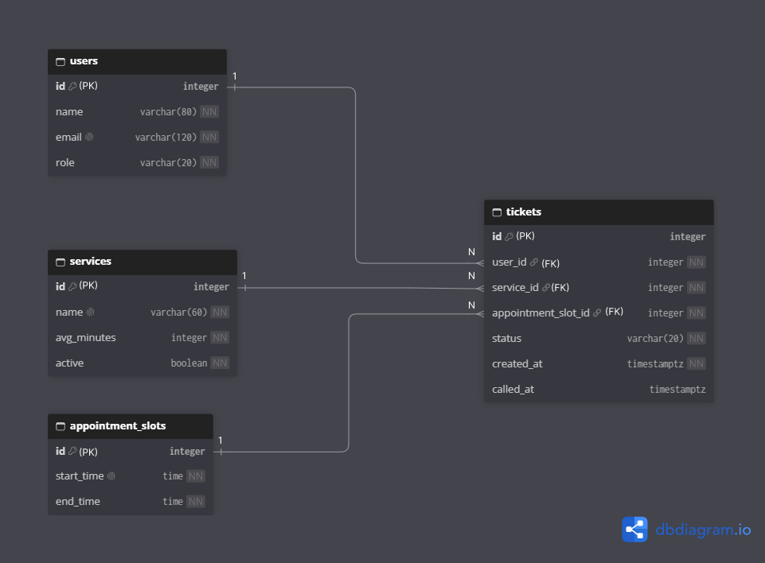

# EDfly schema

## 2a. Nouns in the requirements

| Req ID | Requirement | Nouns | Table or column? |
| --- | --- | --- | --- |
| FR-01 | An **applicant** can join the **queue** for a passport **service** by entering their **name** and **email** and choosing the **appointment slot** they already booked online. | applicant, queue, service, name, email, appointment slot | users, *(not a table)*, services, users.name, users.email, appointment_slots |
| FR-02 | An applicant can see their **ticket number**, **status**, and how many people are **ahead** of them. | ticket number, status, ahead | tickets.id, tickets.status, *(computed)* |
| FR-03 | An applicant can **leave** the queue before being called. | leave (status) | tickets.status |
| FR-04 | A staff member can filter the **waiting list** by passport **service**. | waiting list, service | *(a query on)* tickets.service_id |
| FR-05 | A staff member can **call** the next waiting ticket. | call, called time | tickets.status, tickets.called_at |
| FR-06 | A staff member can mark a called ticket as **served** or **no-show**. | served, no-show | tickets.status |
| FR-07 ★ | A staff member can see each ticket's **appointment slot** and filter the list by slot. | appointment slot | appointment_slots, tickets.appointment_slot_id |
| FR-08 | A staff member can add, **rename** and **switch off** a passport service. | name, active | services.name, services.active |
| FR-09 | A staff member can **delete** a ticket that was created by mistake. | ticket | tickets *(row deleted)* |
| FR-10 ★ | A senior citizen or person with a disability can join a **priority lane** that is served first. | priority lane | *(Later)* decide when it is built |
| FR-11 ★ | An applicant is told which **counter window** to go to when their ticket is called. | counter window | *(Later)* decide when it is built |
| FR-12 | A staff member can see how many people **left** before being served, per service, per **day**. | left, day, count | *(computed from)* tickets.status, tickets.created_at |

- **The queue is not a table.** It is all tickets with status `waiting` in one appointment slot, ordered by `created_at`.
- **Store facts, not results.** "Ahead" and the counts are computed, never stored.

## 2b. Tables

| Table | EDfly Columns |
| --- | --- |
| `users` | id, name, email, role |
| `services` | id, name, avg_minutes, active |
| `appointment_slots` | id, start_time, end_time |
| `tickets` | id, user_id, service_id, appointment_slot_id, status, created_at, called_at |

A fact about the **person** goes in `users`, about the **service** in `services`, about the **time window** in `appointment_slots`, and about **one visit** in `tickets`.

## 2c. Types and constraints

| Table | Column | PostgreSQL type | Constraint | Why |
| --- | --- | --- | --- | --- |
| users | id | integer, generated | PRIMARY KEY | Generated by the database, never reused |
| users | name | varchar(80) | NOT NULL | Staff need a name to call |
| users | email | varchar(120) | NOT NULL UNIQUE | One account per email |
| users | role | varchar(20) | NOT NULL DEFAULT 'visitor', CHECK (role IN ('visitor', 'staff')) | Only two roles exist |
| services | id | integer, generated | PRIMARY KEY | Generated by the database |
| services | name | varchar(60) | NOT NULL UNIQUE | No two services with the same name |
| services | avg_minutes | integer | NOT NULL DEFAULT 10, CHECK (avg_minutes > 0) | Rejects impossible values |
| services | active | boolean | NOT NULL DEFAULT true | Switch a service off without losing its tickets (added by the second migration, Part 9d) |
| appointment_slots | id | integer, generated | PRIMARY KEY | Generated by the database |
| appointment_slots | start_time | time | NOT NULL UNIQUE | Each slot starts once; a real time, not text |
| appointment_slots | end_time | time | NOT NULL, CHECK (end_time > start_time) | A slot cannot end before it starts |
| tickets | id | integer, generated | PRIMARY KEY | The ticket number, never reused |
| tickets | user_id | integer | NOT NULL REFERENCES users(id) | No ticket without an applicant |
| tickets | service_id | integer | NOT NULL REFERENCES services(id) | No ticket for a missing service |
| tickets | appointment_slot_id | integer | NOT NULL REFERENCES appointment_slots(id) | No ticket for a missing slot |
| tickets | status | varchar(20) | NOT NULL DEFAULT 'waiting', CHECK (status IN ('waiting', 'called', 'served', 'no-show', 'left')) | Only these five states exist |
| tickets | created_at | timestamptz | NOT NULL DEFAULT now() | Time zone safe; set by the database; decides the order in line |
| tickets | called_at | timestamptz | none (can be empty) | Empty until staff call the ticket |

**Extra constraint (partial unique index):** `UNIQUE (user_id, service_id) WHERE status IN ('waiting', 'called')` on `tickets`. An applicant can hold only one open ticket per service. Tickets with status `served`, `no-show` or `left` are not counted, so the applicant can join again later.

## 2d. ERD

**Relationships, read aloud:**
- One user has many tickets (1 : N).
- One service has many tickets (1 : N).
- One appointment slot has many tickets (1 : N).
- Each ticket belongs to exactly one user, one service and one appointment slot. The foreign key always sits on the "many" side, which is `tickets`.

**What happens when a parent row is deleted:**

| Foreign key | Rule | Why |
| --- | --- | --- |
| tickets.user_id → users.id | RESTRICT | An applicant with tickets cannot be deleted; old tickets are needed for reports (FR-12). |
| tickets.service_id → services.id | RESTRICT | A service with tickets cannot be deleted; staff switch it off instead (FR-08). |
| tickets.appointment_slot_id → appointment_slots.id | RESTRICT | A slot that tickets used cannot be deleted, so history stays correct. |

Deleting a single ticket (FR-09) is allowed, because a ticket is the "many" side and nothing depends on it.

## 2e. Normalization

1. **One value per cell (1NF):** No. No column holds a list. `email` is one address, `status` is one word, and a slot's start and end are separate columns.
2. **Depends on the whole key (2NF):** There are no join tables, and every table has a single-column primary key, so every column depends on the whole key.
3. **No hidden copies (3NF):** No. An email lives only in `users`, a service name only in `services`, and a slot's times only in `appointment_slots`. `tickets` holds only keys and facts about one visit.

